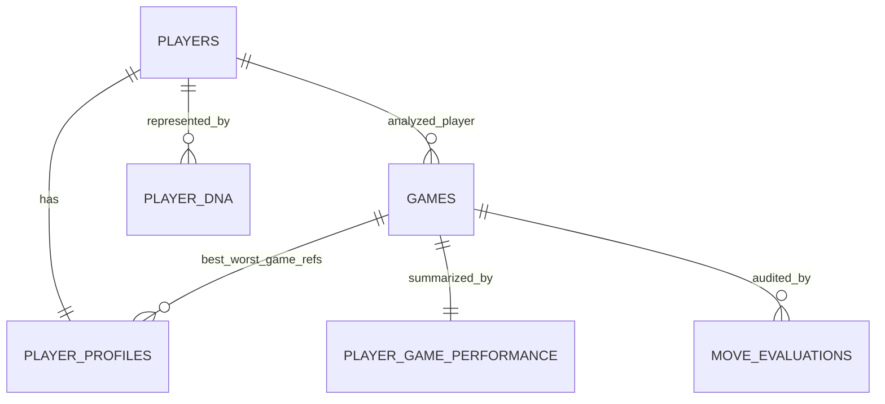

# PostgreSQL data model and migration

## Source-data decisions

The final analysis cohort is 30 players × 40 games = 1,200 selected game
records. `processed_player_games.csv` and
`chess_performance_features_v2.csv` have the same 1,200 `(player_id, game_id)`
keys. `stockfish_move_audit_v2.csv` contains 39,097 move-level records whose
game and player IDs agree with that cohort. `player_profiles.csv` and
`player_dna.csv` each contain 30 unique IDs. Scaler parameters contain the
three approved DNA features.

The 3,000-row `player_game_records.csv` is an earlier 75-player intermediate;
it is retained as a source artifact but not loaded into the selected cohort
database. `player_similarity.csv` is a 2,610-row derived ranking artifact and
is recalculated dynamically from DNA, so similarity pairs are not persisted.
The original dataset and selection files remain unchanged. `selected_games.csv`
has three leading comment lines and a blank line before its header, so it needs
a skip-row setting to read; it is an intermediate input, not the final
processed source.

Opponent identifiers have 1,034 distinct values and none overlap the selected
30-player cohort. They are retained as source IDs on games, without fabricated
opponent profile rows or invalid opponent foreign keys. The database's `players`
table means selected/cohort players; the `player_id` on a game identifies the
analyzed player, and `player_color` identifies the color. The opposing side is
the external `opponent_id`.

## Tables and relationships

### `players`

- **Purpose:** stable identity for the selected cohort.
- **Primary key:** `player_id` (source username).
- **Columns:** `player_id VARCHAR(100)`, `cohort_member BOOLEAN`.
- No rating is stored here because ratings vary by game; ratings remain on game
  records and in aggregated profile statistics. No separate player name is
  present in the final profile source.

### `games`

- **Purpose:** one processed selected player-game record.
- **Primary key:** `game_id`; `player_id` foreign key to `players`.
- **Columns:** `game_id`, `player_id`, `opponent_id`, `player_color`,
  `player_rating`, `opponent_rating`, `winner`, `turns`, `moves_san`,
  `opening_eco`, `opening_name`, `opening_ply`, `rated`, `increment_code`,
  `total_plies_processed`, `player_moves_processed`,
  `opponent_moves_processed`, captures/checks/castles/pawn/piece move counts
  for both sides, promotions for both sides, and `final_fen`.
- The opponent ID is not a foreign key because opponent profiles are not part of
  the selected cohort.

### `player_game_performance`

- **Purpose:** corrected game-level Stockfish summary, one row per analyzed game.
- **Primary/foreign key:** `game_id` is both the primary key and a foreign key
  to `games`.
- **Columns:** `total_player_moves`, `cp_evaluable_moves`,
  `mate_evaluation_moves`, `average_cpl`, `blunders`, `mistakes`,
  `inaccuracies`, `best_moves`, `best_move_percentage`, `accuracy`,
  `missed_forced_mates`, `allowed_forced_mates`, `mate_score_changed`,
  `mate_outcome_preserved`, `engine_name`, `engine_depth`, `cpl_definition`,
  and `accuracy_definition`.
- Mate positions stay separate from ordinary centipawn values; nullable numeric
  values remain SQL NULL.

### `move_evaluations`

- **Purpose:** retain the existing move-level audit for reproducibility.
- **Primary key:** `(game_id, player_move_number)`; `game_id` foreign key to
  `games`.
- **Columns:** `ply_number`, `fen_before`, played and best SAN/UCI moves,
  `best_score_cp`, `best_score_mate`, `played_score_cp`,
  `played_score_mate`, `cpl`, `move_classification`, `mate_event`,
  `engine_name`, `engine_depth`, and `evaluation_method`.

### `player_profiles`

- **Purpose:** Phase 2 aggregate profile, stored as its actual 65 CSV columns.
- **Primary key/foreign key:** `player_id` references `players`.
- **Columns:** `player_id`; integer counts `games_analyzed`, `wins`, `draws`,
  `losses`, games/colors result counts, and mate/CP move totals; floating-point
  win/draw/loss rates, ratings, accuracy, CPL, move rates, best-move rates,
  blunder/mistake/inaccuracy rates, and mate-evaluation rate; plus nullable
  `best_accuracy_game_id`, `worst_accuracy_game_id`, `best_cpl_game_id`, and
  `worst_cpl_game_id` references to `games`.
- The exact profile output columns/types are declared in
  `backend/db/models.py`; all profile CSV fields are retained.

### `player_dna`

- **Purpose:** normalized three-dimensional Player DNA vector, distinct from
  player relationships or matchmaking scores.
- **Primary key:** `(player_id, version)`; `player_id` foreign key to `players`.
- **Columns:** `dna_median_cpl`, `dna_cpl_std`,
  `dna_inaccuracies_per_100_cp_moves`, and `version` (`robust_iqr_v1`).
- Raw features are already in `player_profiles`; they are not duplicated here.

### `dna_feature_scalers`

- **Purpose:** preserve the scaling values used to produce normalized DNA.
- **Primary key:** `(version, feature_name)`.
- **Columns:** `median`, `q1`, `q3`, `iqr_scale`, and `transformation`.

No `matchmaking_results` table is created. Similarities/recommendations are
computed from Player DNA at request time; historical recommendations are not a
current product requirement. Stockfish process state and live recommendation
requests are not stored in PostgreSQL.

## Technology and commands

SQLAlchemy 2.x provides the ORM and repository data access; Alembic versions the
schema; psycopg 3 connects to PostgreSQL. Configuration comes from either
`DATABASE_URL` or `DB_HOST`, `DB_PORT`, `DB_NAME`, `DB_USER`, and `DB_PASSWORD`.
`.env` is ignored by Git; `.env.example` has placeholders only.

1. Copy `.env.example` to `.env` and choose a local password.
2. Run `docker compose up -d postgres` (or provide a PostgreSQL server).
3. Run `alembic upgrade head`.
4. Run `python -m backend.db.import_csv` to load the validated cohort.
5. Run `python -m backend.db.import_csv --verify` to compare row counts, IDs,
   keys, and every imported data field with its source CSV.

The importer runs in a transaction, validates before writing, and refuses to
reload a populated database unless `--replace` is explicit. CSV files are never
deleted or modified.
